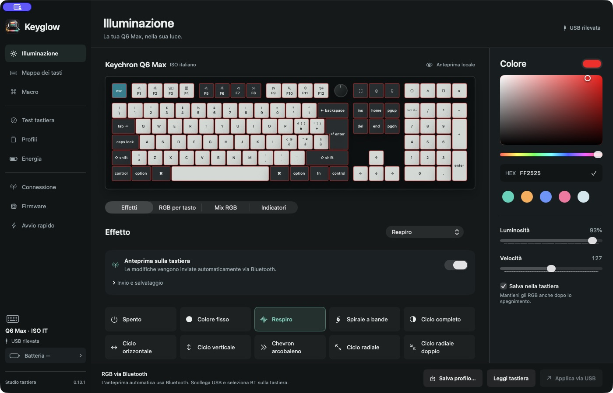
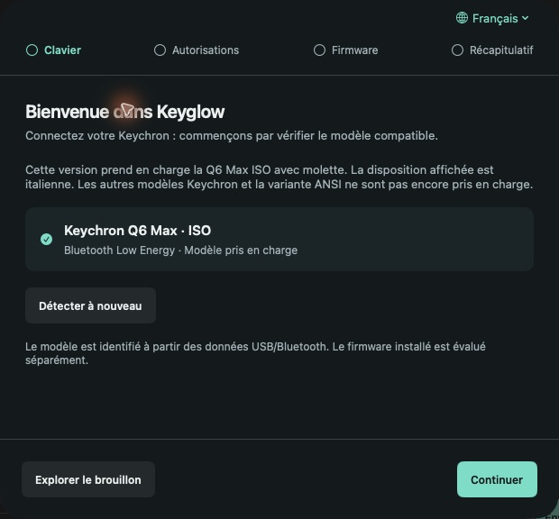
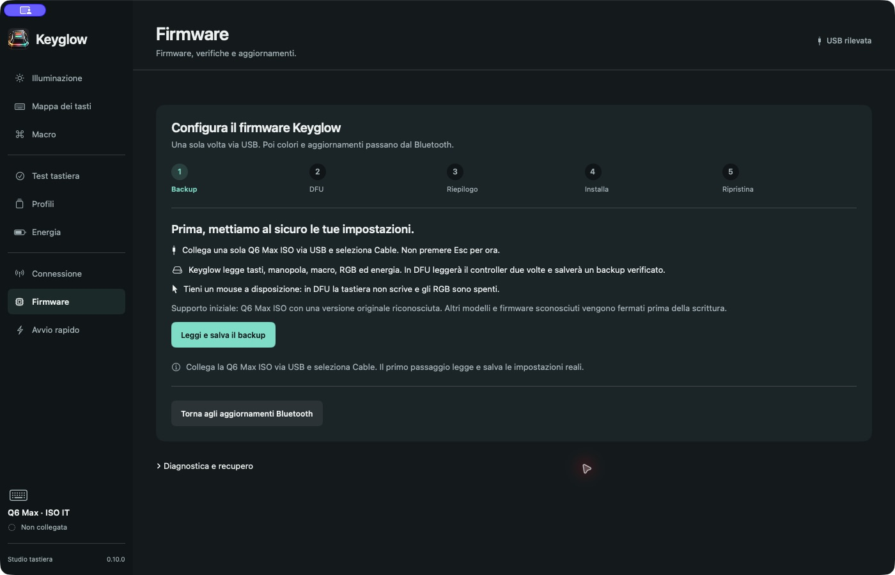
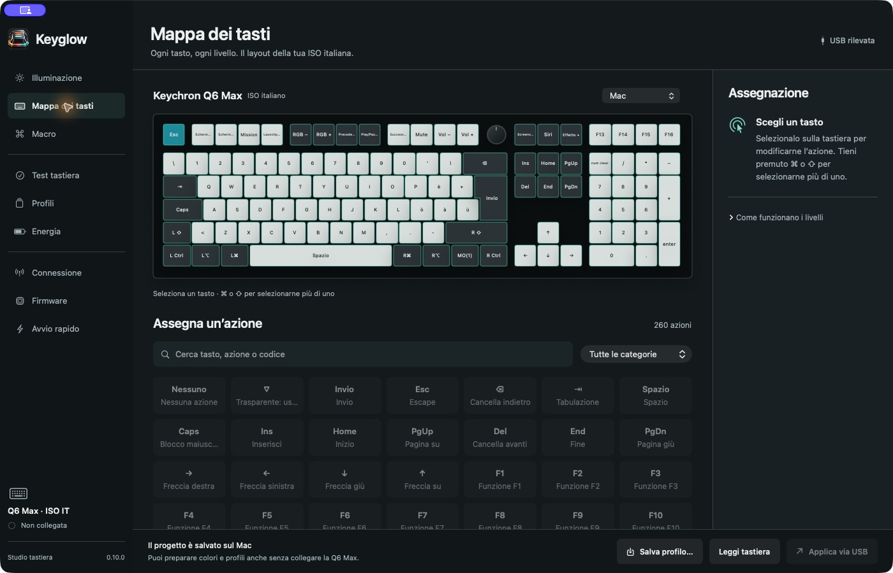

# Keyglow - Tool for Keychron keyboard

**A native macOS app for your keyboard’s lights, layout and profiles.**

Keyglow brings RGB controls, a visual keyboard editor and firmware tools into one desktop app. The current release supports **Keychron Q6 Max ISO with encoder** on Apple Silicon Macs running macOS 13 or later. The interface is available in **Italian, English and French**; the keyboard preview retains the real Italian ISO legends.

[Download the DMG](https://github.com/FrancoisLampasona/Keyglow-Tool_for_Keychron_keyboard/releases/tag/v0.11.0) · [Guida in italiano](docs/it.md) · [Firmware details](docs/firmware.md)



*Actual app screenshot: the local preview represents the Q6 Max ISO with Italian legends, a black case and light/dark keycaps. A preview on screen is separate from the LEDs on the physical keyboard.*

## What is Keyglow?

Choose a color or effect, adjust brightness and speed, and save the result on your keyboard. With the custom Keyglow firmware installed, RGB changes can travel over **Bluetooth**, without plugging in USB or pressing a keyboard shortcut each time. Optional automatic preview sends your latest edits; it is not an instantaneous video stream.

**Battery level** is visible in the sidebar, read from the connected Q6 Max over Bluetooth. It refreshes once a minute while the app is active and idle. Missing, old and unavailable readings are labeled; Cable mode and charging status are not exposed by this reader. Bluetooth permission is requested only when you choose to read it. A normal pause during another operation keeps the last valid reading and resumes automatically when the app can read again.

The complete **Bluetooth → USB → Bluetooth** cycle was physically verified on one Q6 Max ISO with Keyglow 0.11.0, without restarting the app or pressing Refresh/Detect. The sidebar changed from **88%** in Bluetooth to **Battery —** in Cable, then read **92%** after reconnecting in Bluetooth and **91%** automatically the following minute. Profiles and the local configuration stayed unchanged. See the [validation record](docs/dmg-validation.md#physical-bluetooth--usb--bluetooth-cycle--0110).

Over **USB**, Keyglow also lets you edit four keymap layers, the encoder, macros, per-key RGB, mixed effects and supported power settings. Profiles stay on your Mac. You can prepare a draft without a keyboard and apply it explicitly when connected.

Keyglow is an independent, open-source project, **not affiliated with or endorsed by Keychron**. Despite the project name, it is not a universal configurator for every Keychron keyboard.

## Install the app

1. Download **Keyglow-0.11.0-macOS-arm64.dmg** from the [release page](https://github.com/FrancoisLampasona/Keyglow-Tool_for_Keychron_keyboard/releases/tag/v0.11.0).
2. Open the DMG and drag **Keyglow** into **Applications**.
3. Open Keyglow from Applications, then eject the installation disk.
4. Choose **Italiano**, **English** or **Français** in the first-run assistant, then follow **Keyboard → Permissions → Firmware → Summary**.

The DMG includes the public firmware package and USB tools; you do not need Python, Homebrew, Xcode or this repository to run it. Moving the whole app does not move or delete your profiles and backups.

**Experimental release:** the app is locally signed and **not notarized by Apple**. The development certificate is not a trusted Developer ID on another Mac. If macOS blocks opening it, review the source and release before using the system’s per-app approval. Do not disable system security globally.

## Choose your language

Use the globe menu in the first-run assistant or at the bottom of the sidebar. The change takes effect immediately and is remembered on your Mac; Italian is the initial default. Navigation, controls, guidance and app messages use the selected language. The app does not send text to a translation service.

Changing language leaves profile names, macro contents, key assignments and physical keyboard legends unchanged. macOS-owned windows may follow the system language. See the [localization guide](docs/localization.md) for translation contributions.



*The language can be changed in the setup assistant or the sidebar, without changing the keyboard’s physical layout.*

## First launch and firmware setup

The assistant first checks the keyboard model. **ANSI, JIS, other models and the 2.4 GHz receiver are not supported by this release.** It then explains Input Monitoring and opens the relevant macOS settings when access is missing. Your consent remains a system action; a valid existing permission is reused.

The original Keychron firmware does **not** accept Keyglow RGB commands over Bluetooth. You can choose USB configuration, use an already provisioned keyboard, or enter the first-install assistant.



The initial firmware setup stays inside the app:

1. Connect USB, select **Cable**, and save the actual keyboard configuration.
2. Authorize the owner key while the keyboard can still type a macOS password.
3. Follow the DFU instructions. Keyglow reads the controller twice and saves a verified backup.
4. Review the exact files and approve installation. The app writes and reads back the prepared image before writing and verifying the loader.
5. Reconnect in Cable mode and restore the saved configuration, with settings readback.

Opening the page does not start a flash. An already installed target version is detected and directed to Bluetooth updates. Unknown firmware images are blocked. The initial catalog recognizes the official Q6 Max ISO v1.1.0 image dated March 25, 2025.

**The new integrated first-install path has software coverage but is not yet validated physically from beginning to end.** The first loader write is not power-loss safe, and independent hardware recovery remains unverified. Keep the cable connected during writes and retain the private backups. See the [validation record](docs/dmg-validation.md) and [firmware limits](docs/firmware.md).

## What uses Bluetooth, and what needs USB?

| Feature | Connection | Current status |
| --- | --- | --- |
| Color, brightness, speed and 22 RGB effects | Bluetooth + custom firmware | Implemented; selected effects physically verified on one Q6 Max ISO |
| Save RGB across keyboard power-off | Bluetooth + custom firmware | Green Breathing and persistence physically verified |
| Automatic RGB preview while editing | Bluetooth + custom firmware | Latest edits queued; blue Breathing confirmed at 20 ms |
| Keymap, encoder, macros, per-key RGB and Mix | USB | Read, edit, apply and verify; capabilities depend on firmware |
| Battery percentage | Bluetooth, including stock firmware | Automatic readings verified on one Q6 Max ISO; unavailable and old readings distinguished |
| Energy settings | USB | Includes the experimental Reattiva policy; latency and battery impact not measured |
| Profiles, import/export, preview and foreground key test | Local app | No account required |
| Controller firmware updates | Bluetooth + Keyglow loader and owner key | Build 8 → 9 completed through resumed transfers on one keyboard |
| First loader installation | USB + DFU | Guided in-app; experimental |

RGB sends do not have a device acknowledgement: macOS accepting the reports is different from the keyboard displaying the requested color. Firmware transfers use a separate acknowledged protocol.

**Use only the mouse during Bluetooth verification and updating.** Pressing keys or moving the encoder interrupts the transfer. Progress shows confirmed data; verified blocks can be resumed. Updating while typing is not supported, and the updater does not update the proprietary radio firmware. A full uninterrupted transfer at 20 ms has not been established.

## Make the keyboard yours



The editor keeps a local draft until you apply it. Profiles separate personal configurations, automatic recovery copies and a restorable trash. Loading a profile does not silently send RGB commands. The sidebar supports full-row clicks and ⌘1–9 shortcuts; the window adapts down to 900 × 640.

The app does not run a background keystroke recorder. Macro recording and the key test are explicit foreground actions. Quick Launch registers only shortcuts you choose. There is no analytics service, account or cloud profile sync. Owner keys, macros, profiles and device backups must not be attached to public issues.

## Build and contribute

For a basic app build, install Xcode or Command Line Tools with **Swift 6**:

```sh
zsh scripts/build-app.sh
open dist/Keyglow.app
```

The basic build does not bundle first-install tools. See [complete build and packaging](docs/firmware.md#bundling-the-first-install-assistant), [stable local signing](docs/local-signing.md), [contributing and tests](CONTRIBUTING.md), and [build cleanup](docs/build-cleanup.md).

The custom firmware is based on [Keychron QMK revision 2b493ff](https://github.com/Keychron/qmk_firmware/tree/2b493ff95f2665db719b1e95c91babb5036e72f3). The release includes corresponding source for the frozen A8/B9 images. Host tests cannot establish radio reliability, actual macOS consent behavior or power-loss recovery.

## License

**GPL-2.0-or-later**. See [LICENSE](LICENSE) and [third-party notices](THIRD_PARTY_NOTICES.md). Keychron names identify compatible hardware and are not project branding. This project is unrelated to other applications named KeyGlow.
