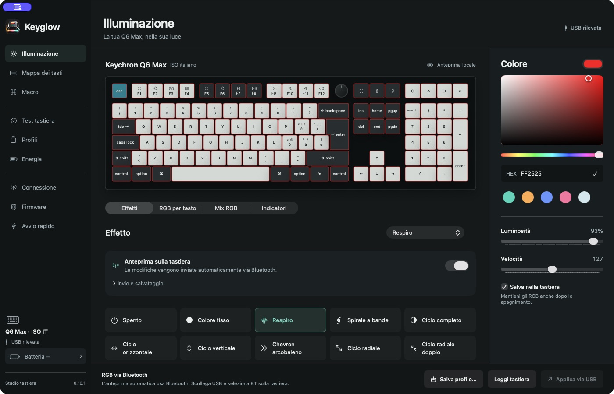
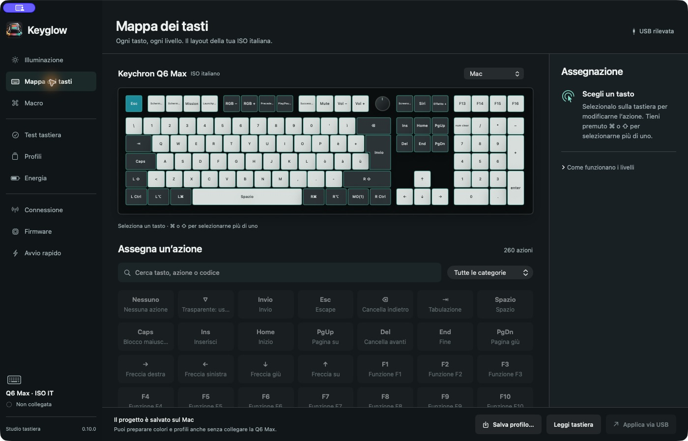
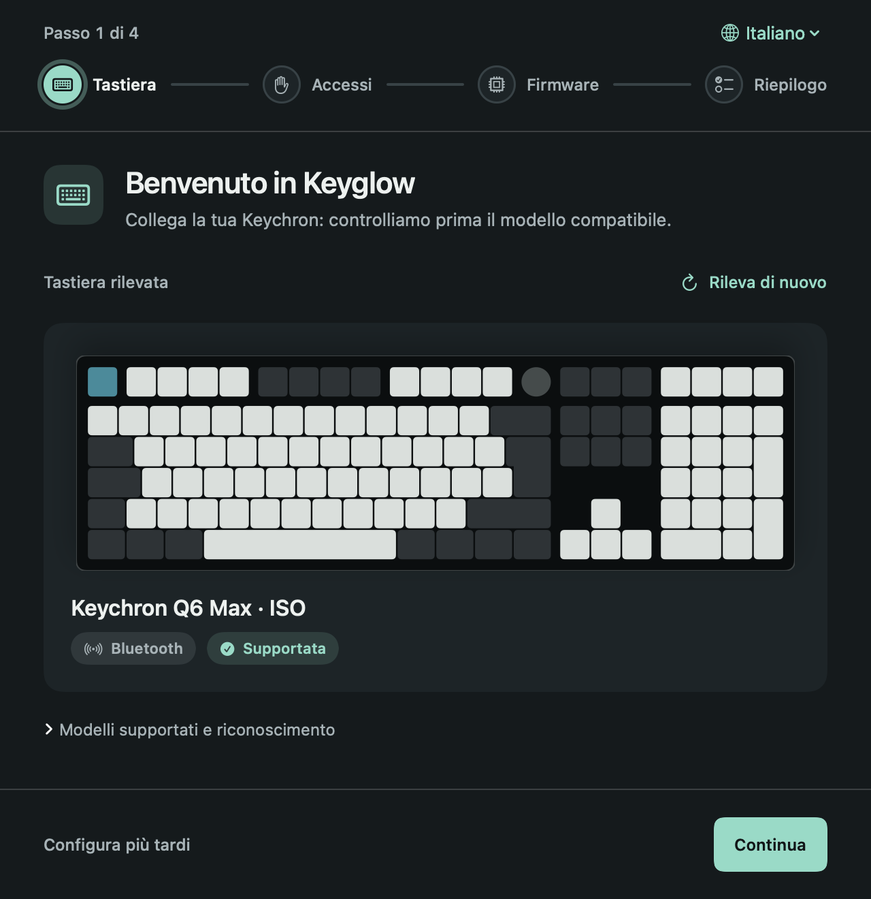
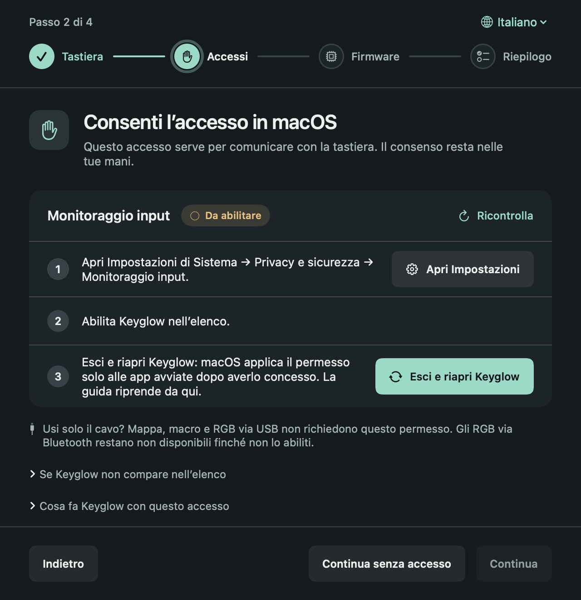
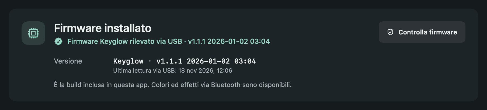
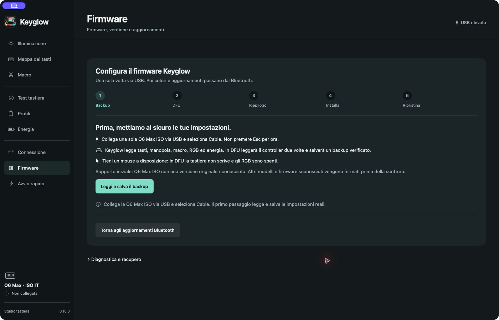
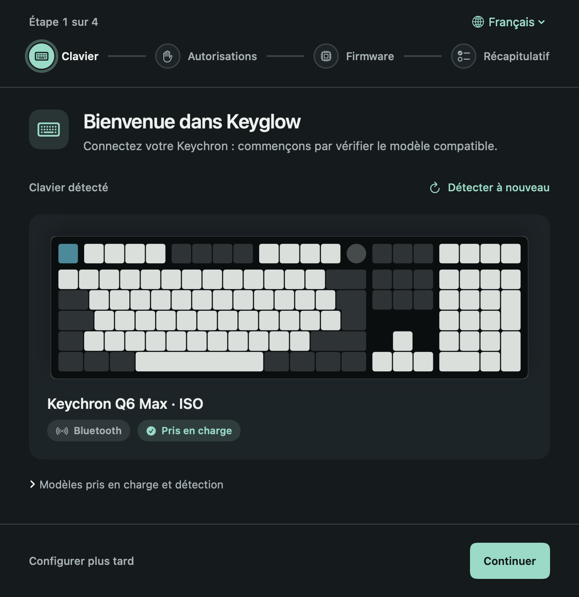

# Keyglow - Tool for Keychron keyboard

**A native macOS app for your keyboard’s lights, layout and profiles.**

Keyglow brings RGB controls, a visual keyboard editor and firmware tools into one desktop app. It supports the **Keychron Q6 Max ISO with encoder** on Apple Silicon Macs running macOS 13 or later. The interface is available in **Italian, English and French**; the keyboard preview keeps the real Italian ISO legends.

[Releases and downloads](https://github.com/FrancoisLampasona/Keyglow-Tool_for_Keychron_keyboard/releases) · [Release notes 0.12.0](docs/release-notes-0.12.0.md) · [Guida in italiano](docs/it.md) · [Firmware details](docs/firmware.md)



*App screenshot from 0.10.1; the sidebar and several pages changed in 0.12.0. A preview on screen is separate from the LEDs on the physical keyboard.*

Keyglow is an independent, open-source project, **not affiliated with or endorsed by Keychron**. Despite the project name, it is not a universal configurator for every Keychron keyboard: **ANSI and JIS variants, other models and the 2.4 GHz receiver are not supported.** There is no Windows or Linux version.

## What it does

- **Lighting over Bluetooth**, with the custom Keyglow firmware: color, brightness, speed and 22 effects, saved on the keyboard. An optional automatic preview sends your latest edits.
- **Full configuration over USB**: four keymap layers, the encoder, macros, per-key RGB, mixed effects and supported power settings, read from the keyboard, edited as a local draft and applied only when you choose.
- **Profiles on your Mac**: save, update, load, import and export; automatic recovery copies and a restorable trash. Undo and Redo for draft edits.
- **Battery level** in the sidebar, read over Bluetooth once a minute while the app is open; an optional low-battery notification.
- **Firmware tools**: check which firmware is installed, update the controller over Bluetooth, and a guided first installation over USB.
- **Optional conveniences**, all off until you turn them on: open at login, a menu bar item with battery, quick colors and profiles, and Quick Launch shortcuts.



*App screenshot from 0.10.0.*

## Install

1. Download **Keyglow-…-macOS-arm64.dmg** from the [releases page](https://github.com/FrancoisLampasona/Keyglow-Tool_for_Keychron_keyboard/releases). The newest version is at the top.
2. Open the disk image and drag **Keyglow** into **Applications**.
3. Open Keyglow from Applications, then eject the disk image.

You do not need Python, Homebrew, Xcode or this repository to run the app. Moving the app does not move or delete your profiles and backups.

**About macOS security.** From 0.12.0 the app is signed with an Apple Developer ID certificate. Each release’s notes say whether its disk image is also notarized by Apple: a notarized image opens without warnings; an image that is not notarized is blocked by Gatekeeper until you approve that one app in **System Settings → Privacy & Security**. Review the release before doing so, and never disable system security globally. Releases up to 0.11.1 were locally signed and not notarized.

## First launch



*Rendered from the app’s own view with synthetic data.*

The guide has four steps: **Keyboard → Permissions → Firmware → Summary**. Choose Italiano, English or Français from the globe menu at any time.

1. **Keyboard.** Keyglow identifies the Q6 Max ISO over USB or Bluetooth. An unsupported model is reported and nothing is sent to it.
2. **Permissions.** macOS requires **Input Monitoring** for an app to talk to a keyboard’s HID interface. Keyglow does not record typing in the background; macro recording and the key test are explicit foreground actions. You grant the permission yourself in System Settings. macOS applies it only to apps started after it is granted, so the guide offers **Quit and Reopen Keyglow** and resumes at this step. If you only use the cable, **Continue Without Access** skips it: USB configuration works, Bluetooth RGB stays unavailable.
3. **Firmware.** Say whether the keyboard already has the Keyglow firmware, needs it, or will be used over USB only. With a cable connected, Keyglow reads the firmware version and tells you what it found.
4. **Summary.** What is ready, what is not, and which page opens next.



## Firmware: Bluetooth and USB

The original Keychron firmware does **not** accept Keyglow RGB commands over Bluetooth. Over USB, keymap, macros and RGB work with a VIA-compatible firmware.

## What uses Bluetooth, and what needs USB?

| Feature | Connection | Current status |
| --- | --- | --- |
| Color, brightness, speed and 22 RGB effects | Bluetooth + custom firmware | Implemented; selected effects physically verified on one Q6 Max ISO |
| Save RGB across keyboard power-off | Bluetooth + custom firmware | Green Breathing and persistence physically verified |
| Automatic RGB preview while editing | Bluetooth + custom firmware | Latest edits queued; blue Breathing confirmed at 20 ms |
| Keymap, encoder, macros, per-key RGB and Mix | USB | Read, edit, apply and verify; capabilities depend on firmware |
| Battery percentage | Bluetooth, including stock firmware | Automatic readings verified on one Q6 Max ISO; unavailable and old readings distinguished |
| Energy settings | USB | Includes the experimental Reattiva policy; latency and battery impact not measured |
| Profiles, import/export, preview and foreground key test | Local app | No account required |
| Controller firmware updates | Bluetooth + Keyglow loader and owner key | Build 8 → 9 completed through resumed transfers on one keyboard |
| First loader installation | USB + DFU | Guided in-app; experimental |

RGB sends do not have a device acknowledgement: macOS accepting the reports is different from the keyboard displaying the requested color. Firmware transfers use a separate acknowledged protocol.

**Use only the mouse during Bluetooth verification and updating.** Pressing keys or moving the encoder interrupts the transfer. Progress shows confirmed data; verified blocks can be resumed. Updating while typing is not supported, and the updater does not update the proprietary radio firmware. A full uninterrupted transfer at 20 ms has not been established.

### Checking what is installed

The **Firmware** page shows an **Installed Firmware** card with a **Check Firmware** button.



- **With a cable**, the check reads the firmware version over USB. This is the conclusive answer.
- **Over Bluetooth**, the check asks the Keyglow firmware to answer on the indicator channel. It takes about 45 seconds and you must not type or touch the knob meanwhile. A valid answer means Keyglow is installed; it is authenticated only if this Mac holds the keyboard’s owner key. No answer does **not** prove the original firmware is installed: connect the cable to be sure.

The check only reads. The last version read stays visible, with its date.

### First installation

The first installation of the Keyglow firmware is done **over USB**, guided inside the app:

1. Connect USB, select **Cable**, and save the actual keyboard configuration.
2. Authorize the owner key while the keyboard can still type a macOS password.
3. Follow the DFU instructions. Keyglow reads the controller twice and saves a verified backup.
4. Review the exact files and approve installation. The app writes and reads back the prepared image before writing and verifying the loader.
5. Reconnect in Cable mode and restore the saved configuration, with settings readback.



*App screenshot from 0.10.0.*

Opening the page does not start a flash. Unknown firmware images are blocked. The catalog recognizes the official Q6 Max ISO v1.1.0 image dated March 25, 2025.

**Risks, stated plainly.** Flashing firmware can leave a keyboard unusable. The integrated first-install path has software test coverage but **has not been validated physically from beginning to end**. The first loader write is not power-loss safe, and independent hardware recovery has not been verified. Keep the cable connected during writes and keep the backups. A source-only build of the app does not include the first-install tools; each release’s notes say whether its disk image does. See the [validation record](docs/dmg-validation.md) and [firmware limits](docs/firmware.md).

### Updates over Bluetooth

A keyboard that already has the Keyglow loader can receive controller updates over Bluetooth, authorized with the owner key created on the Mac used for the first installation. **Use only the mouse during verification and updating**: keys and the knob interrupt the transfer, and verified blocks can be resumed. The updater does not update the proprietary radio firmware. One build 8 → 9 update was completed on one keyboard through resumed transfers; a full uninterrupted transfer at 20 ms has not been established.

## Updating the app

**Keyglow → Check for Updates…** reads this repository’s public release list when you choose it and tells you whether a newer version exists, with a link to its page. Nothing is checked in the background, downloaded or installed. To update, download the new disk image and replace the app in Applications.

If an update changes how the app is signed (as 0.12.0 does, compared with earlier builds), macOS treats it as a different app for Input Monitoring: remove the old Keyglow entry with **−**, add the app again with **+**, then use **Quit and Reopen Keyglow**.

## Where your data lives

| Data | Location |
| --- | --- |
| Saved profiles | `~/Library/Application Support/Keyglow/Profiles/` |
| Keyboard backups made before applying over USB | `~/Library/Application Support/Keyglow/Backups/` (newest 50) |
| Draft, language and options | macOS preferences of the app |
| Firmware owner key | macOS Keychain |

Nothing is uploaded. There is no account, analytics or cloud sync. The only network request is the optional update check described above. Profiles can contain personal macros: do not attach profiles, backups or keys to public issues.

## Troubleshooting

- **The permission stays “Needs permission” after enabling it.** macOS applies Input Monitoring only to apps started afterwards: use **Quit and Reopen Keyglow**.
- **Keyglow is enabled in Input Monitoring but the app still cannot use it.** The entry belongs to an older copy or build. Remove it with **−**, add the app again with **+**, then quit and reopen.
- **The firmware check over Bluetooth is slow or gets no answer.** It takes about 45 seconds by design; do not type during it. After an unanswered request the button counts down for a minute. For a certain answer, connect the cable and check again.
- **Colors do not change over Bluetooth.** They require the Keyglow firmware; RGB sends have no device acknowledgement, so check the keyboard itself.
- **Quitting.** Only one copy of Keyglow runs at a time. With the menu bar item enabled, closing the window keeps the app running; use **Quit Keyglow** from the menu.

## Languages

Use the globe menu in the setup guide or at the bottom of the sidebar. The change takes effect immediately and is remembered. It does not change profile names, macro contents, key assignments or the physical keyboard legends, and no text is sent to a translation service. See the [localization guide](docs/localization.md).



## Build from source

Use an Apple Silicon Mac with full **Xcode** (Swift 6); the Command Line Tools alone cannot compile the SwiftUI views.

```sh
zsh scripts/build-app.sh
open dist/Keyglow.app
```

A source build is ad-hoc signed unless you configure a signing identity, and it does not bundle the first-install tools. See [complete build and packaging](docs/firmware.md#bundling-the-first-install-assistant), [stable local signing](docs/local-signing.md), [contributing and tests](CONTRIBUTING.md) and [build cleanup](docs/build-cleanup.md).

The custom firmware is based on [Keychron QMK revision 2b493ff](https://github.com/Keychron/qmk_firmware/tree/2b493ff95f2665db719b1e95c91babb5036e72f3). Host tests cannot establish radio reliability, actual macOS consent behavior or power-loss recovery.

## Project status

Keyglow is experimental and developed on a single Q6 Max ISO. What was verified on real hardware, and what was only tested in software, is recorded in the [validation record](docs/dmg-validation.md). Known limits: one supported keyboard variant, no notarization guarantee for every release, a slow Bluetooth firmware check, an unvalidated end-to-end first installation, and no measurement yet of the latency and battery impact of the experimental energy policy.

## License

**GPL-2.0-or-later**. See [LICENSE](LICENSE) and [third-party notices](THIRD_PARTY_NOTICES.md). Keychron names identify compatible hardware and are not project branding. This project is unrelated to other applications named KeyGlow.
