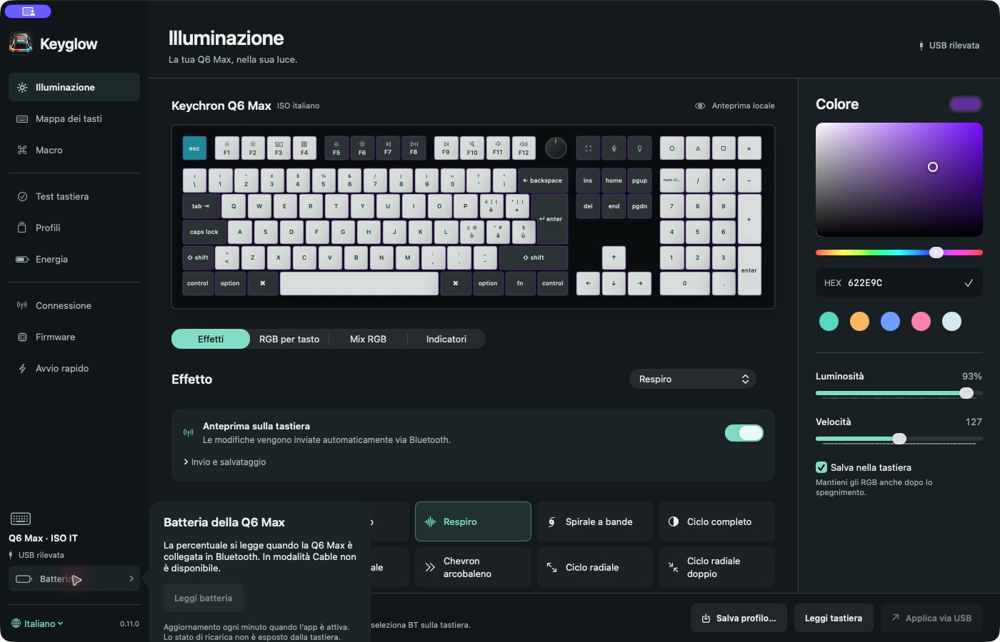
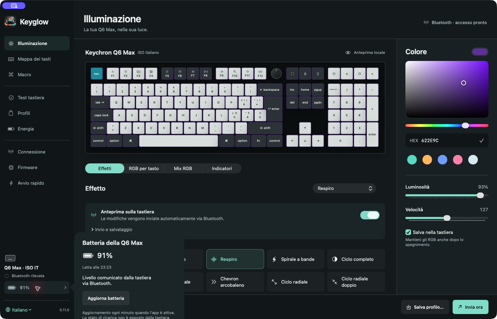

# DMG and first-run validation — 2026-10-27

Tested release: **Keyglow 0.10.0, build 22**, Apple Silicon.

DMG SHA-256: `c44a62e019c07aa19636eff4b9d981487fc2be3c7f8877f5725b2cd1a60ed406`.

## Completed on the Mac

- Downloaded the published DMG from the renamed GitHub repository and matched the release digest.
- Mounted it read-only; installed its exact app bundle at `/Applications/Keyglow.app`. Remote Finder dragging did not complete the copy, so the identical bundle was copied with the macOS file-copy tool. Every file was compared and the signature verified.
- Saved private copies of existing app preferences, profiles and recovery files before testing. No personal data was included in screenshots or committed.
- Started the distributed app with temporarily empty app preferences. The first-run assistant appeared automatically.
- Recognized one Q6 Max ISO over USB, displayed the access explanation, reused an existing valid Input Monitoring grant, explained custom firmware requirements, and opened the in-app installation assistant.
- Read the keyboard configuration twice over USB. The first-install assistant correctly detected the already installed target and refused to reinstall it.
- Restored and compared all original app preferences exactly after the first-run test.
- Captured the actual installed application's lighting, keymap and guided-install pages for the README. They use a local default draft, not an invented hardware result.

## Not established by this test

**A complete first firmware installation was not performed.** This keyboard already had the custom loader and build 9. Testing the stock-to-Keyglow path would require a separately approved return to stock firmware after a complete controller backup.

Two attempts to enter DFU with Esc did not enumerate an STM32 DFU device; the Mac continued to identify the normal Q6 Max. The physical reset-button attempt was deferred by the owner. No firmware, loader, protection bits or factory-reset command was written. The second Esc attempt changed keymap, lighting and sleep settings. The saved pre-test VIA snapshot was restored using the production transport; two full readbacks then matched that snapshot exactly, including macros. Firmware was unchanged. The app preferences also matched the pre-test copy exactly.

This was a clean **app-preferences** test on an existing macOS account. Input Monitoring, Keychain and local certificate trust were not reset. It does not prove the consent flow on a new macOS account or another Mac.

Gatekeeper's read-only assessment returned **rejected**. The release has a stable local signature, not a trusted Developer ID/notarization. Successful launch on the development Mac must not be described as a frictionless installation on a fresh Mac. No global protection was disabled and no quarantine flag was removed for this test.

The in-memory installer tests and previous manual bootstrap/OTA evidence remain separate; see [firmware validation and limits](firmware.md).

## Data and cleanup

Private recovery material is retained outside the checkout under the user's Application Support directory. Generated build outputs and the duplicate checkout app can be removed without moving or resetting the installed app's preferences. Only `/Applications/Keyglow.app` is retained as the active app. The repository retains source, tests, licenses, public documentation and README screenshots.

## Battery update — 0.10.1, build 23

The battery extension uses the existing read-only CoreBluetooth identity and Battery Level parser. It does not modify the controller firmware. Automatic refresh requires an existing Bluetooth authorization, one detected Q6 Max, an active app and no competing operation; the Firmware page pauses it. An explicit read can request the separate Bluetooth permission. Values outside 0–100 are rejected, reads older than three minutes are marked previous, and disconnected/Cable mode has no percentage. No charging or runtime estimate is inferred.

Identity/parsing and freshness/refresh-gating tests passed. The native sidebar and Cable explanation were inspected at 1400 × 900 and 900 × 640. A physical Bluetooth test subsequently read 96% at 18:27, then 94% at 18:31 and 92% at 18:52 on October 27, 2026 (Europe/Rome). The latter two readings appeared automatically, without pressing **Aggiorna batteria**. The native popover showed the device percentage and read time. These observations verify automatic refresh/resumption on this Q6 Max ISO, not a precisely measured one-minute cadence or battery-life estimate.

The complete 0.10.1 DMG was mounted read-only and its files matched the installed app, with strict signature verification and bundled USB-helper launch. A separate signing test confirmed stable reciprocal requirements between different binaries and rejection of wrong identities/ad-hoc replacements. No privacy permissions were reset.

Final 0.10.1 DMG SHA-256: `a6493a24d0823b4e868ece2802c72fbf9cd97d479369a412789e182bcb234a6f`. The UI review resolved a cached-connection issue: USB/Bluetooth metadata refreshes on activation and every five seconds while active and unpaused, including when disconnected. The owner’s subsequent USB → Bluetooth transition was recognized without restarting Keyglow. At this stage the complete round trip had not been tested; the later 0.11.0 physical test below completes that check.

## Multilingual update — 0.11.0, build 24

The app adds Italian, English and French presentation, with a language menu in the first-run assistant and sidebar. Italian remains the initial default. The selection uses a separate local preference; it does not rewrite the keyboard definition, profiles, macro content or protocol identifiers. Translation resources are bundled and require no online service. Native system windows can retain the macOS language.

Catalog checks passed for English/French coverage parity, interpolation parameters, Unicode and literal braces in filenames, multiline fallback, preservation of user-provided names and the stored language preference. The main sources passed Swift 6 type checking. These software checks do not establish a complete VoiceOver journey. The native checks below cover the rendered paths and inspected accessibility labels, not a full screen-reader session.

Normal battery-read cancellation for another operation is now a pause rather than a failed reading. It preserves a valid value and clears the retry delay, so reading can resume when the app becomes eligible. This change does not alter the keyboard firmware. No firmware installation was performed during the multilingual work.

### Final app and DMG checks

The installed 0.11.0 app was inspected in Italian, English and French at 1400 × 900 and 900 × 640. Language changed immediately in navigation, lighting controls, effects, app-owned menus and the setup assistant without resetting its step. French persisted after quitting and reopening. The first-install instructions and step labels were checked in English and French without starting a hardware operation; the existing Input Monitoring grant remained valid. A targeted independent UI review found no remaining material issues in this localization scope.

The final app was returned to Italian. Before/after preference exports confirmed `workspace.v3` and `profiles.v3` were byte-identical, including macro content; the only changed preference was the new `app.language = it`. No RGB command was sent by changing language or navigating. The final UI retained the same color and reported a real 92% battery reading automatically.

The new DMG was mounted read-only. Every app file matched `/Applications/Keyglow.app`; strict signature verification and the bundled USB helper's version command passed. The stable-signature test also passed across distinct binaries and rejected wrong identities and ad-hoc replacements. The DMG includes installation notes in all three languages and the same public A8/B9 firmware payloads; no owner key or device backup is bundled.

0.11.0 DMG SHA-256: `446956230cee6ece609ee9a1e13d27f327aa8100d8fd79f0b507c1f0869a37d4`.

These packaging and localization checks did not include a physical USB/Bluetooth round trip. That separate check is recorded below. Fresh-Mac consent, the integrated first-install hardware path and Apple notarization remain unverified or unavailable as documented above.

## Physical Bluetooth → USB → Bluetooth cycle — 0.11.0

On October 27, 2026, the owner physically switched a Q6 Max ISO from Bluetooth to USB/Cable and back to Bluetooth. Keyglow 0.11.0 (build 24) remained open from `/Applications` throughout, with the same process ID before and after. No Detect, Refresh, Read keyboard or Apply button was pressed, and no permission was reset. The app was brought to the foreground for automatic refresh and remained on Lighting, with no firmware operation running.

| Stage | Connection shown automatically | Battery result |
| --- | --- | --- |
| Initial Bluetooth | Bluetooth detected; access ready | Fresh **88%**, read at **23:19** |
| USB connected, selector Cable | USB detected | **Battery —**; the popover explained that Cable cannot provide this reading |
| USB removed, selector BT | Bluetooth detected; access ready | Fresh **92%**, read at **23:22** |
| Following automatic refresh | Bluetooth detected; access ready | **91%**, read at **23:23** |

Times are Europe/Rome. The initial stale reading was replaced automatically, the Cable transition cleared it, and reconnecting in Bluetooth produced a fresh reading. The subsequent timestamp and value changed without a manual refresh. The percentages are device-reported levels; they do not establish charging status, measurement accuracy or a battery-life estimate. This test verifies foreground refresh and both connection transitions on this keyboard, not continuous background polling or an exact transition latency.

Before/after digests of `workspace.v3`, `profiles.v3` and `app.language` matched. The same color, effect and profile data were preserved. No firmware, RGB setting or keyboard configuration was written during this test. No app rebuild or DMG replacement was necessary.

## Background monitoring — 0.11.1, build 25

Connection and battery monitoring now belong to the app model, rather than the sidebar view or foreground activation. The monitor checks public connection metadata about every five seconds and reads the battery about once a minute, using an existing Bluetooth grant. It remains running while Keyglow is behind another app or minimized. It does not scan for new peripherals, write HID reports, access the owner key or automatically request permission. An explicit first battery read may still request consent; a pending consent prompt is not cancelled by the polling timer.

Device operations and the Firmware page pause monitoring. System sleep cancels a pending read; wake makes a fresh read eligible. A scoped `ProcessInfo` activity keeps this requested monitoring from being deferred by App Nap while allowing idle system sleep, and is released on pause, sleep or termination. See Apple's [activity options](https://developer.apple.com/documentation/foundation/processinfo/activityoptions) and [activity guidance](https://developer.apple.com/library/archive/documentation/Performance/Conceptual/power_efficiency_guidelines_osx/PrioritizeWorkAtTheAppLevel.html). These scheduling choices are not a measurement of energy use or a guarantee while the Mac is asleep or Keyglow has quit.

The installed app was physically tested on the same Q6 Max ISO on October 27, 2026. The owner kept another app active for the final cycle. Local debug events recorded `NSApplication.isActive == false` at each connection transition and battery completion below; reading the accessibility state did not activate Keyglow.

| Time (Europe/Rome) | Observed automatically in background |
| --- | --- |
| 23:37:56 | Bluetooth detected after removing USB |
| 23:37:57 | Battery **92%** |
| 23:38:57 | Next battery read **90%**, without activation or Refresh |
| 23:39:51 | USB/Cable detected; sidebar changed to **Battery —** |
| 23:41:22 | Bluetooth detected again; fresh battery read **93%** |

The [sanitized event record](validation/background-status-20261027.json) contains timestamps, connection flags, percentages and the foreground flag only. An earlier USB transition occurred while macOS still considered Keyglow active; it was excluded from this background proof and repeated. The final Bluetooth → USB → Bluetooth cycle used one uninterrupted app process, no manual Detect/Refresh action and no permission reset. Digests of `workspace.v3`, `profiles.v3` and `app.language` matched before and after. No keyboard settings or firmware were written. Percentages are the device's reports, not a charging-state or battery-life estimate.

The monitor tests use a fake reader and clock to cover first consent, permission denial, one-minute retry spacing, unchanged percentage with a fresh timestamp, Cable transitions, replacement identity, operation cancellation, sleep/wake and stop/restart without hardware access. Bluetooth identity/parser tests, localization checks, onboarding checks, workspace preservation tests and the Live RGB suite passed; the final app compiled in Swift 6 and retained its stable signing requirement. Sleep/wake policy was covered by software tests; this session did not suspend the physical Mac.

The 0.11.1 DMG was mounted read-only: all 24 app files matched `/Applications/Keyglow.app`, strict signature verification passed, and the bundled USB helper launched. The public firmware and corresponding source archive remain unchanged. Apple notarization and the integrated first-install hardware limits are unchanged.

DMG SHA-256: `ceb45027426d1ba953d4afb5f7e0a1daf4d0f133048b40c0d24358bc782a9d90`.
